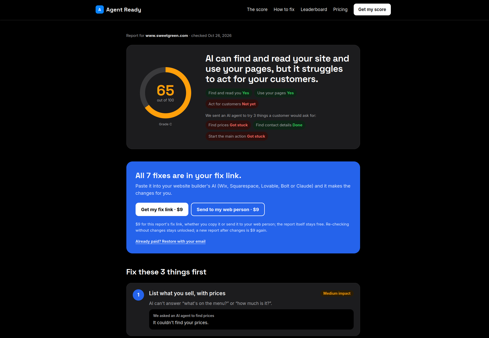

# Agent Ready

**Lighthouse for AI agents.** People increasingly ask Claude, ChatGPT and Perplexity to find a restaurant, book a service or compare prices, and the agent too often comes back with "sorry, I couldn't find the menu." Agent Ready scores how well AI agents can use a website and tells the owner, in plain language, what to fix.

**Live:** https://agentready.sfo.unikraft.app



## How it works

1. **Checks the page.** 60 checks read the real site: can agents get in (robots.txt, bot walls), understand it (hours, location, menus, prices, contact) and take action (MCP/A2A/OpenAPI endpoints, declared actions, labeled forms)?
2. **Sends an agent.** A Claude agent (Sonnet, run through [Omnara](https://docs.omnara.com)) tries the things a customer would ask for, like finding prices or contact details, and records every step.
3. **Gives one score.** Checks and agent results combine into a single 0–100 score and grade across six weighted categories, with fixes ranked by impact for that kind of business.
4. **Hands over a fix link.** The owner pastes one link into their site builder's AI (Wix, Squarespace, Lovable, Bolt, Claude) or sends it to their developer, then re-checks.

Sites that block bots get no score. Instead the report names the blocker (Cloudflare, DataDome, Akamai and others), explains how to let agents in, and lists the site in its own section of the leaderboard.

More on the problem and who it's for: [docs/problem-solution.md](docs/problem-solution.md). How the single score is produced: [docs/one-final-score.md](docs/one-final-score.md).

## Use it

- **Web:** `/report?url=example.com`
- **Leaderboard:** `/leaderboard`, filter by business type with `?type=restaurant`
- **JSON API:** `GET /api/audit?url=example.com` or `POST /api/audit` with `{ "url": "..." }`
- **MCP server:** `/api/mcp` (streamable HTTP), tools `audit_site` and `generate_fixes`

```bash
claude mcp add --transport http agent-ready https://agentready.sfo.unikraft.app/api/mcp
```

## Built with

Next.js 15 and TypeScript, Supabase (audits, leaderboard, fix links), Claude Sonnet via Omnara (the agent), Context.dev (logos and business categories), Stripe test mode (the $9 fix link, see [docs/payments.md](docs/payments.md)), and Unikraft Cloud (hosting), deployed by GitHub Actions.

## Run it locally

```bash
pnpm install
cp .env.example .env   # fill in the keys you have
pnpm dev               # http://localhost:3000
```

Every key is optional; the app degrades instead of failing. Without Supabase nothing is saved, without the Omnara vars the agent step fails, without Context.dev there are no logos and categories fall back to keywords, and without Stripe fix links are free. For Supabase, run `supabase/schema.sql` and `src/lib/agent/schema.sql` in your project's SQL editor.

## Code map

- **Checks:** `src/lib/audit/checks.ts`, one entry per line of `evals/AGENT_CHECKS.md`. Each is a `{ id, category, title, weight, method, run(ctx) }` object, so adding one is a single array entry.
- **Scoring:** `src/lib/audit/rubric.ts`. Checks are rated 0–4, `na` or `unknown` (unknown lowers coverage, never the score). Categories A–F are weighted 15/20/25/15/15/10, and a category counts once 25% of it is measured.
- **Blocked sites:** `src/lib/audit/blocked.ts` detects the bot wall and writes the unblock steps.
- **Agent:** `src/lib/agent/`. With `AGENT_RUNTIME=omnara`, Omnara runs the loop and model and our tools (`src/lib/agent/tools.ts`) run as custom tools on our server; otherwise `src/lib/agent/model.ts` calls Claude directly (`ANTHROPIC_API_KEY`). Guardrails are in `src/lib/agent/guard.ts`.
- **Pages and API:** `src/app/` (report, leaderboard, `/api/agent`, `/api/audit`, `/api/mcp`).

```bash
pnpm test && npx tsc --noEmit && pnpm lint                  # what CI runs
AGENT_STUB=1 pnpm agent https://example.com "find pricing"  # agent with fake steps, no model
pnpm agent https://example.com "book a demo"                # real agent run
```

## Deploy

Every push to `main` deploys to Unikraft Cloud (`.github/workflows/deploy.yml`): it runs the tests, builds the image, swaps it onto the running instance and checks the site. Pull requests get tests and a production build first (`ci.yml`).

The workflow needs the `UNIKRAFT_TOKEN` secret and the `UNIKRAFT_ORG`, `UNIKRAFT_INSTANCE` and `UNIKRAFT_SERVICE` variables (the service name sets the URL, `https://<service>.sfo.unikraft.app`). If the instance doesn't exist, the first run creates it.

The instance's env vars come from repository secrets named as in `.env.example`, and every deploy sets them again. To rotate a key, update the secret (`gh secret set CONTEXT_DEV_API_KEY`) and re-run the workflow from the Actions tab. The optional `AGENT_DAILY_BUDGET` variable sets how many new agent runs a day are allowed (default 50).
